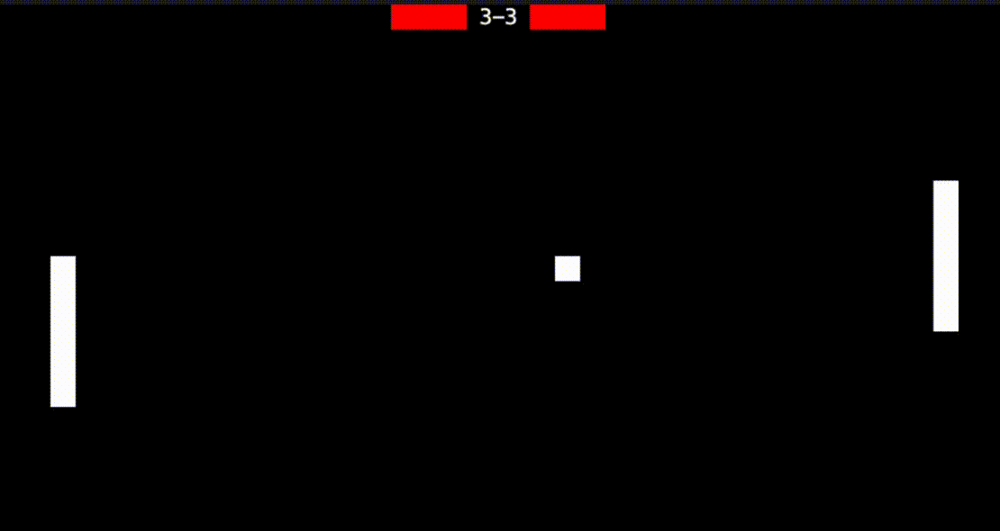

# CLI GAMES
cli games is a collection of some short classic games that runs directly in your terminal and can be served over ssh. 




## HOW TO RUN
### copy this command, paste it in your terminal and run
```
ssh -p 2222 guest@2a01:4f9:3080:3192::2078
```
alternativly you may run the python file (main.py) directly.

## CONTROLS
#### Menu
- Use the arrow keys to navigate the menu. 
- press enter to select an option

#### Pong
- W/A/Up/Down = set paddles movement direction
- Space = stop moving paddle
- Q = quit game
- any key = restart game after death

#### Pong
- WASD/Arrow keys = move the snake
- Q = quit game
- any key = restart game after death

## CURRENTLY INCLUDED GAMES
- Pong
- Snake